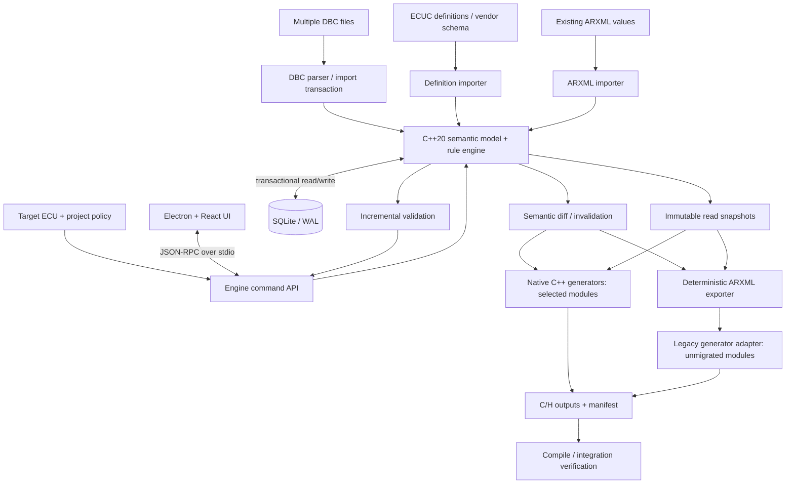

# AUTOSAR Dependency-Driven Studio

> **Engineering architecture & verification specification**
> Status: partial implementation; persisted DBC import, channel scoping, ECU queries and read-only project inventory are available. ECUC/ARXML and generation remain unimplemented.
> Scope: multi-DBC import, ECU-centric configuration UX, AUTOSAR ECUC definition/value model, C++20 configuration engine, incremental validation and generation, legacy differential verification.

## Implementation baseline

The latest implementation and gate-by-gate evidence are recorded in [the acceptance report](docs/verification/acceptance-2026-11-08.md). The historical description below describes the preceding preview-only slice; the following capabilities supersede its DBC persistence limitations:

- `dbc.import` transactionally stores canonical absolute source identities, SHA-256 digests, original supplied UTF-8 text, parser version, revisions, typed nodes/messages/signals/receivers and source lines in SQLite schema v2. Every import explicitly specifies channel and classic CAN/CAN FD policy. Reimporting identical input preserves source identity and revision. Same-channel frame conflicts reject the entire batch; identical IDs on separate channels are allowed.
- `dbc.sources` and `network.ecu` query persisted facts after restart. The UI previews files, asks for channel/frame policy, explicitly saves them, and presents ECU-specific Tx/Rx links and messages. Sample text remains preview-only. Unknown nodes are diagnosed and never become resolved network peers.
- `project.inspect` and the UI's **Inspect Eclipse project** action return a deterministic read-only SHA-256 inventory, preserving actual path spelling. Symlinks/reparse points are reported and not traversed; build wrappers are never executed. This is an inventory adapter, not a complete Eclipse metadata/build adapter.
- Validation covers 11/29-bit CAN IDs, explicit FD payload lengths, Intel/Motorola occupancy, ordinary/simple-multiplex overlaps, finite nonzero scaling and ordered physical bounds. Attributes, comments, extended multiplexing, vendor records and other unsupported declarations retain their raw source text and diagnostics; their semantics are not interpreted. E2E/SecOC/diagnostic policy remains `UNRESOLVED`, and generation remains blocked.

When CMake is unavailable on a MinGW-equipped host, use this reproducible fallback (Node.js 24 was used for verification):

```powershell
node scripts/build-engine.mjs --output=build/acceptance
$env:STUDIO_ENGINE_PATH = (Resolve-Path build/acceptance/studio-engine.exe).Path
Set-Location apps/desktop
npm.cmd run test:engine
npm.cmd run test:acceptance
npm.cmd run build -- --configLoader native
```

The fallback builds and executes both C++ test suites. A separate output directory avoids overwriting an engine already running in Electron. Vite's native config loader avoids ancestor-directory scans blocked by some Windows sandboxes. CMake defines a reusable `studio-core` library and both CTest targets; CMake/CTest were unavailable in the inspected host. No admin rights or execution-policy changes are needed for these commands.

### Historical preview-only baseline

The repository currently contains a C++20 JSON-RPC engine and an Electron/React shell. It previews DBC files with `dbc.parseBatch` on a bounded C++ worker pool, offers a stateless message/signal comparison through `dbc.diff`, and validates a project definition through `project.configure`. Project definitions are persisted by the C++ engine in a versioned SQLite database; the Electron application uses its per-user application-data directory, and the standalone engine accepts `STUDIO_DATABASE_PATH` (default: `studio.sqlite3` in its working directory). SQLite migrations and project updates are transactional, and failed writes do not replace the in-memory or persisted definition. This is the first persistence slice only: imported DBC content, source provenance, ECUC values, dependency indexes, and generated artifacts are not yet stored. Batch parsing parallelizes independent files and reports possible cross-file message-name/frame-ID overlaps as unresolved warnings; it does not treat them as conflicts because DBC files have not yet been assigned to network/channel scopes. `dbc.diff` reports message-level semantic fields, matching by unique message name first and unique frame ID second. It never guesses a match if both keys change; duplicate keys that cannot be uniquely paired are reported as adds/removes. The comparison is scoped to the two parsed inputs and is not a persisted project identity/change set. The draft captures DBC source names, MCU target, OS periodic/event/ISR requirements, DCM services, and traceable software requirements. Durable DBC import, explicit cross-file network identity, dependency invalidation, full DBC dialect coverage, ARXML/ECUC validation, and C/H generation are not implemented. Numeric DBC attributes are compared as parsed lexical values in this first diff implementation, so equivalent decimal spellings may be reported as changes. The DBC preview is not a claim of AUTOSAR support.

### Eclipse project compatibility is a core requirement

Electron is the configuration UI; the existing Eclipse project remains the ECU software's development and build unit. The engine must not impose a replacement project format. An Eclipse Project Adapter opens and inspects existing projects in place, preserves their configuration and unknown project-specific files, and writes generated artifacts only to explicitly resolved destinations.

```text
DBC sources ─────┐
                 ├── AUTOSAR Studio project definition (DBC + SRS)
MCU / OS / DCM ──┘                    │
                                      ▼
                         C++20 Configuration Engine
                         bounded worker pool / tests
                                      │
                                      ▼
                         SQLite configuration model
                         (project definition persistence implemented)
                         ├── Eclipse Project Adapter ── .project / .cproject
          │       ├── Configuration/  (ARXML inputs and ECUC values)
          │       ├── Generated/       (owned, configured generator outputs)
          │       ├── Static_Code/     (preserved source)
          │       ├── CryptoLib/       (preserved library)
          │       ├── Build/           (project-specific build outputs)
          │       └── Debug/           (project-specific debug outputs)
          ├── Native C++ generators (qualified module/output ownership)
          ├── Legacy Xtend adapter (compatibility and differential baseline)
          └── Optional SCons/BAT build adapter ── existing build environment
```

Folder names above describe observed project conventions, not mandatory directories to create or rename. Discover actual spelling, capitalization, and roles from each project and its scripts; in particular, preserve a project's existing directory name rather than normalizing it. `Static_Code` is the intended spelling in this documentation.

The existing SCons/Python and BAT workflows are compatibility targets, not confirmed implementation dependencies for every project. Configuration, code generation, and build are separate operations: the engine owns configuration and validation; generator adapters own explicitly assigned outputs; and an optional build adapter may invoke the existing BAT/SCons workflow without taking over compilation itself. Keep Xtend available initially for unsupported modules and comparisons, then qualify native C++ replacements module-by-module. Never allow two generators to write the same artifact in one run.

Project qualification must verify that `.project` and `.cproject` remain usable in Eclipse; `Configuration/` ARXML resolves against the project's ECUC definitions; generated files land only in the correct existing locations; `Static_Code/`, `CryptoLib/`, and other user-owned content are unchanged; and `Build/`/`Debug/` roles and the real build invocation are established from the project's scripts and observed behavior. `.cproject` alone is not authoritative: inspect whether a project uses CDT managed build, Makefiles, external scripts, BAT wrappers, SCons, or vendor tools such as Tasking. Compare the legacy Xtend pipeline and native output for the same frozen inputs before migrating generator ownership.

Build the engine from the repository root, then install and run the desktop app:

```powershell
cmake -S . -B build
cmake --build build --config Debug
Set-Location apps\desktop
npm.cmd install
npm.cmd run build
npm.cmd run test:engine
ctest --test-dir ..\..\build -C Debug --output-on-failure
npm.cmd run dev
```

The engine executable is expected at `build\engine\studio-engine.exe` on Windows. Set `STUDIO_ENGINE_PATH` to override that location. C++ engine logs go to stderr; stdout is reserved for newline-delimited JSON-RPC messages. Electron uses a sandboxed preload bridge with context isolation enabled and Node integration disabled.

The engine uses the vendored SQLite 3.54.1 amalgamation under `third_party/sqlite`. Electron persists the project definition in its per-user application data directory. When running the engine directly, set `STUDIO_DATABASE_PATH` to a writable database file; otherwise it creates `studio.sqlite3` in the current working directory. The v1 schema stores only the validated project definition and revision, not DBC contents or generated outputs.

`npm.cmd run dev:web` starts the renderer in a browser for layout checks; engine-backed controls require the Electron bridge. In the Electron app, **Add DBC files** opens a multi-file chooser and the drop zone accepts `.dbc` files. `dbc.parseBatch` validates the batch, then parses independent files on the bounded C++ worker pool while preserving input order; its response also contains cross-file overlap warnings. Warnings identify repeated frame IDs or message names across selected files and list their source files. They are review prompts only: without explicit network/channel assignments, the engine cannot decide whether the identifiers collide on one bus or are valid on separate buses, and it does not merge or reject the messages. `dbc.diff` is currently an engine/API and test-harness operation; it compares `beforeText`/`afterText`, reports added/removed/modified/unchanged messages, exact changed message fields, nested signal fields, and both parse issue lists. It is not yet surfaced in the renderer as a saved baseline comparison. The preview interprets `BU_`, `BO_`, and `SG_` declarations. Other nonempty source records (except `NS_` section headers and their keyword entries) produce a `DBC_UNSUPPORTED_DECLARATION` warning with a source line and are counted in `unsupportedLines`; those records are not retained, persisted, or round-tripped, so this remains a non-lossless preview rather than a complete importer.

The **Project definition** form records the selected MCU identity, OS task trigger (periodic/polling with period, event, or ISR), DCM service IDs, and free-form SRS requirement IDs/text. The engine checks required fields, trigger-specific data, duplicate task/service/requirement IDs, and task period bounds. The validated project definition and DBC source names are persisted in SQLite and restored when the engine starts; source DBC contents and preview results are not yet imported into the database. This is not an MCU catalog, an AUTOSAR OS configuration generator, or a DCM implementation. Manufacturer-specific MCU catalogs, OS semantics, DCM service parameters/security policy, and project SRS templates need real target-project inputs rather than invented defaults.

Native tests use CTest (`studio-engine-unit`) for DBC parsing, SRS validation and actual concurrent worker execution. The Node JSON-RPC smoke test covers the Electron-facing engine protocol, including batch parsing and project draft configuration. The UI is currently build-checked and manually exercised; automated renderer interaction tests are not yet configured.

The license-safe smoke fixture in [fixtures/synthetic/eclipse_can_project](./fixtures/synthetic/eclipse_can_project) includes `.project`, `.cproject`, representative project folders, a DBC, and illustrative ECUC definition/value ARXML. It is intended for parser and project-adapter development only. It is not a real legacy comparison project, has no Xtend-generated baseline, and its ARXML has not been validated against an AUTOSAR XSD or vendor PDF. Real differential claims require approved, frozen existing Eclipse projects and their exact generator/build outputs; do not substitute synthetic fixtures for those controls.

## 0. Executive technical contract

The product is a **configuration engine with a graphical network view**, not a graphical ARXML editor. Users drop multiple DBC files, choose their ECU (e.g., BDC), inspect Tx/Rx communication relationships, resolve only genuinely undecidable policy questions, and receive consistent configuration and generated artifacts. ARXML remains a supported standards-compatible exchange/output format; users should not need to understand its file layout or an explicit Harmonize operation.

**The legacy pipeline is the comparison baseline, not an implementation blueprint to port:** `DBC → ARXML → manual per-module configuration → existing Harmonize → Xtend/Java generator → C/H → build`. The proposed pipeline is `DBC + ECU intent + ECUC definitions + project/vendor policy → C++ semantic model/SQLite → incremental derive/validate → ARXML export + native C/H generation where supported → build`. Unmigrated modules may still use legacy ARXML export + generator adapters. Do not recreate a user-visible Harmonize stage.

**Non-negotiable invariants:** (1) reproducible configuration and generation; (2) source provenance and user overrides preserved; (3) transactional consistency; (4) no invented E2E/SecOC/diagnostic semantics from DBC alone; (5) no silently dropped AUTOSAR variants/vendor extensions; (6) measured parity against multiple real projects, including independent checks beyond legacy outputs; (7) generated BSW ABI and behavior compatible with the target BSW runtime; (8) no claim of AUTOSAR compliance merely because outputs match the old generator.

**Explicit non-goals for the initial native generator:** full RTE replacement, all MCAL/OS/Dcm replacement, AI as authoritative config writer, text-level patching of generated C, arbitrary cross-version ARXML support, project scheduling/budget/resource estimates.

## 1. Vocabulary and system boundaries

| Term | Precise meaning |
|---|---|
| DBC source | CAN network description with BO_/SG_/BU_, multiplexing, attributes, sender/receiver metadata where present; not a full AUTOSAR policy model |
| ECU intent | Selected target ECU, channel mapping, OS/MCU/BSW target, project-specific settings and policy choices |
| ECUC Module Definition (PDF) | AUTOSAR ECUC schema data, e.g. `Dcm_ECU_Configuration_PDF.arxml`, defining containers, parameters, references, types, multiplicity, constraints |
| ECUC Module Configuration Values | Actual values, e.g. `Dcm.arxml`, with `DEFINITION-REF` pointing at ECUC definitions |
| Model reference graph | Relationships among *existing* model objects and references |
| Configuration dependency graph | Rules describing how changing one property may create/update/validate/invalidate *other objects or generated outputs*, including not-yet-existing objects |
| Baseline | Existing Eclipse/ARTOP/EMF/Harmonize/Xtend toolchain on a frozen input/project/environment |
| Native generator | New C++ implementation of a specific BSW output contract, not a generic AUTOSAR-compliant C generator |
| Semantic equivalence | Same relevant model meaning after canonical normalization; not necessarily byte-identical XML |
| Runtime equivalence | Equivalent configured behavior/ABI for supported cases, demonstrated by tests, not assumed |

A BDC label is an ECU identity chosen from project metadata; do **not** infer its expansion or behavior from the acronym.

## 2. Architecture: ports, adapters, ownership



### 2.1 Strict ownership

- **Electron main process**: application lifecycle, sandboxed file chooser/drop file-path resolution, launching/restarting the engine, IPC bridge; no SQL and no AUTOSAR semantics.
- **React renderer**: display network graph, message lists, filtered inspectors, validation issues, provenance, diffs; no authoritative configuration inference.
- **C++ engine process**: exclusive configuration write authority; DBC/ARXML parsing, normalization, ID allocation, policy application, derivation, validation, dependency tracking, generation scheduling, transaction and artifact publication.
- **SQLite**: persisted canonical project state, definitions/values, provenance, indexes, dependencies, validation issues, artifact manifests; not a dump of raw XML strings.
- **Legacy adapter**: frozen baseline execution and transitional generation for non-native modules; never controls the canonical DB.
- **AI advisor (optional)**: explanations and proposed changes from structured engine facts; no direct DB writes or assertion of validity. The engine alone validates and commits.

### 2.2 Suggested repository structure

```text
autosar-studio/
├── README.md
├── CMakeLists.txt
├── CMakePresets.json
├── .editorconfig
├── .gitignore
├── docs/
│   ├── adr/                    # Architecture decision records
│   ├── schemas/                # IPC JSON schema + DB migrations
│   ├── generation-contracts/   # Module-specific runtime ABI contracts
│   └── verification/           # Comparison protocol and evidence schema
├── apps/
│   └── desktop/
│       ├── package.json
│       ├── electron/           # main, preload, lifecycle
│       └── src/                # React, React Flow, state, inspectors
├── engine/
│   ├── include/studio/         # Public C++ interfaces
│   ├── src/
│   │   ├── app/                # command dispatch, JSON-RPC transport
│   │   ├── dbc/                # lexer/parser, semantics, multiplexing
│   │   ├── arxml/              # import/export, namespace, variants
│   │   ├── ecuc/               # definition/value model and constraints
│   │   ├── store/              # SQLite migrations, repositories, transactions
│   │   ├── rules/              # derivation + validation + dependency metadata
│   │   ├── graph/              # reference and dependency indexes
│   │   ├── generation/         # snapshot, task DAG, fragments, assembler
│   │   ├── generators/         # com/, pdur/, canif/ as individually migrated
│   │   ├── artifacts/          # staging, manifests, atomic publish
│   │   └── diagnostics/        # error codes, source mapping, trace
│   └── tests/
├── adapters/
│   └── legacy/                 # isolated ARXML export and tool invocation
├── fixtures/
│   ├── synthetic/              # license-safe tiny DBC/ARXML fixtures
│   └── manifests/              # external project fixture references only
├── verification/
│   ├── runner/                 # baseline/new orchestration
│   ├── canonicalizers/         # ARXML/C/H/model comparison helpers
│   ├── comparators/
│   └── reports/                # generated; typically ignored
└── scripts/
    └── dev/                    # setup, build, test, run
```

Existing Electron prototype should be **integrated**, not rewritten: keep its layout, replace hard-coded/demo data with typed IPC client contracts. CMake builds the engine separately; frontend build is independently testable.

## 3. Data flow and command semantics

### 3.1 Import multiple DBCs

1. UI collects file handles and asks main process to resolve permitted local paths.
2. Engine computes SHA-256 and reads files into a staging import session; parsing failures never partially update live project state.
3. Parse CAN identifiers (standard/extended), frame length, signals, bit start/length, byte order, signedness, scaling, offsets, units, value tables, multiplexing, attributes and ECU transmitter/receiver declarations. Preserve unknown attributes as typed extension records.
4. Normalize each network/channel and message to **stable semantic identities**, not only filenames. DBC file origin is provenance, not identity; same numeric CAN ID on different channels is allowed.
5. Detect collisions and ambiguities: duplicate frame ID on same bus, incompatible frame definitions across files, conflicting signal definitions, unknown receiver nodes, inconsistent multiplexing and unsupported attributes. Emit issues with file/line/field and remediation; do not silently choose a winner.
6. Show a preview diff: added/modified/removed/unchanged/ambiguous entities and impacted ECU relationships. Confirm project-level import before commit.
7. Commit source snapshots and normalized entities in a single transaction. Reimport of unchanged content is idempotent.
8. Trigger scoped derivation and validation; display unresolved decisions instead of forcing a dialog for every message.

DBC alone cannot determine all E2E profiles, SecOC security settings, diagnostic routing, network-channel binding, or vendor-specific implementation options. Rule evaluation distinguishes `inferred`, `policy_default`, `user_confirmed`, `imported`, and `unknown`; `unknown` can block generation when required.

### 3.2 ECU-centric read model

A network edge represents a **user-level communication relationship**, not every ARXML reference. Edge identity includes project, channel, ECU pair and direction as needed; clicking an edge opens its constituent messages. Some DBCs lack sufficient receiver information; represent unknown or broadcast relationships explicitly rather than inventing peers. Avoid N×N clutter by filtering to selected ECU, grouping by bus, aggregating edges and providing search.

Network View answers: *which ECU communicates with whom, on which bus, and through which messages?*  Message Inspector answers: *what does this message contain and what configuration/policy is currently applied?*  Configuration Inspector answers: *which validated ECUC values and generated artifacts implement that decision?*  Advanced View exposes ARXML definition paths and references for engineers without imposing them on general users.

### 3.3 API protocol (proposed)

Use **JSON-RPC 2.0 over newline-delimited JSON on stdio** for the initial desktop-engine boundary. Define request IDs, cancellation tokens, engine/project revision, structured errors, protocol version negotiation and progress events. Large graph responses must be paginated; no 100k-node UI payloads. Engine process writes only protocol frames to stdout, logs to stderr. Electron renderer communicates only via a narrow `contextBridge` preload API; `contextIsolation=true`, `nodeIntegration=false` and no arbitrary shell execution.

```json
{"jsonrpc":"2.0","id":41,"method":"project.importDbc","params":{"projectId":"p1","paths":["/data/a.dbc","/data/b.dbc"],"mode":"preview","expectedRevision":8}}
```

```json
{"jsonrpc":"2.0","id":41,"result":{"importSessionId":"s7","baseRevision":8,"changes":{"added":12,"modified":2,"conflicts":1},"issues":[{"code":"DBC_FRAME_CONFLICT","severity":"error","source":{"file":"/data/b.dbc","line":91},"entityId":"..."}]}}
```

Representative methods: `project.create/open`, `project.importDbc`, `project.commitImport`, `project.selectTargetEcu`, `network.listNodes/listEdges`, `message.list/get`, `configuration.get/previewChange/commitChange`, `validation.list/explain`, `generation.preview/run`, `artifact.list/diff`, `baseline.compare`. Mutation requests carry `expectedRevision` (optimistic concurrency) and return the new revision. Event streams include import progress, validation changes and generation completion. Version schema contracts and integration-test the IPC layer.

## 4. Canonical model and SQLite schema

### 4.1 Definitions vs values (never conflate)

`Dcm_ECU_Configuration_PDF.arxml` describes ECUC container/parameter/reference **definitions**: type, multiplicity, allowed ranges, defaults and reference target restrictions. `Dcm.arxml` contains ECUC **configuration values** with `DEFINITION-REF` paths to those definitions. The DB uses a **generic relational schema for all modules**, not `CREATE TABLE DcmDslConnection(...)` per module. Definition-level constraints can be generic; cross-module/project/vendor constraints require explicit rules.

### 4.2 Proposed schema sketch (illustrative, not complete migration)

```sql
PRAGMA foreign_keys = ON;
PRAGMA journal_mode = WAL;

CREATE TABLE projects (
  id TEXT PRIMARY KEY, name TEXT NOT NULL, autosar_release TEXT NOT NULL,
  bsw_vendor TEXT, bsw_version TEXT, revision INTEGER NOT NULL DEFAULT 0
);
CREATE TABLE sources (
  id TEXT PRIMARY KEY, project_id TEXT NOT NULL REFERENCES projects(id),
  kind TEXT NOT NULL, logical_name TEXT NOT NULL, sha256 TEXT NOT NULL,
  path TEXT, imported_at TEXT NOT NULL, metadata_json TEXT NOT NULL DEFAULT '{}'
);
CREATE TABLE definitions (
  id TEXT PRIMARY KEY, project_id TEXT NOT NULL REFERENCES projects(id),
  autosar_path TEXT NOT NULL, kind TEXT NOT NULL, parent_id TEXT REFERENCES definitions(id),
  value_type TEXT, lower_mult INTEGER, upper_mult INTEGER,
  definition_payload_json TEXT NOT NULL DEFAULT '{}',
  UNIQUE(project_id, autosar_path)
);
CREATE TABLE config_objects (
  id TEXT PRIMARY KEY, project_id TEXT NOT NULL REFERENCES projects(id),
  definition_id TEXT NOT NULL REFERENCES definitions(id),
  parent_id TEXT REFERENCES config_objects(id), short_name TEXT NOT NULL,
  variation_json TEXT NOT NULL DEFAULT '{}',
  origin_kind TEXT NOT NULL, origin_source_id TEXT REFERENCES sources(id)
);
CREATE INDEX idx_config_parent ON config_objects(project_id,parent_id);
CREATE INDEX idx_config_definition ON config_objects(project_id,definition_id);
CREATE TABLE parameter_values (
  id TEXT PRIMARY KEY, object_id TEXT NOT NULL REFERENCES config_objects(id),
  definition_id TEXT NOT NULL REFERENCES definitions(id),
  value_kind TEXT NOT NULL, value_text TEXT, value_int INTEGER,
  value_real REAL, value_bool INTEGER, value_json TEXT,
  origin_kind TEXT NOT NULL, origin_source_id TEXT REFERENCES sources(id),
  is_user_override INTEGER NOT NULL DEFAULT 0
);
CREATE INDEX idx_parameter_object ON parameter_values(object_id,definition_id);
CREATE TABLE config_references (
  id TEXT PRIMARY KEY, source_object_id TEXT NOT NULL REFERENCES config_objects(id),
  definition_id TEXT NOT NULL REFERENCES definitions(id),
  target_object_id TEXT REFERENCES config_objects(id),
  unresolved_target_path TEXT, origin_source_id TEXT REFERENCES sources(id)
);
CREATE INDEX idx_ref_source ON config_references(source_object_id);
CREATE INDEX idx_ref_target ON config_references(target_object_id);
CREATE TABLE dbc_entities (
  id TEXT PRIMARY KEY, project_id TEXT NOT NULL REFERENCES projects(id),
  kind TEXT NOT NULL, bus_id TEXT, parent_id TEXT REFERENCES dbc_entities(id),
  semantic_key TEXT NOT NULL, payload_json TEXT NOT NULL,
  UNIQUE(project_id, kind, semantic_key)
);
CREATE TABLE source_mappings (
  id TEXT PRIMARY KEY, source_id TEXT NOT NULL REFERENCES sources(id),
  source_entity_key TEXT NOT NULL, config_object_id TEXT REFERENCES config_objects(id),
  dbc_entity_id TEXT REFERENCES dbc_entities(id), rule_id TEXT
);
CREATE TABLE rules (
  id TEXT PRIMARY KEY, version TEXT NOT NULL, kind TEXT NOT NULL,
  scope TEXT NOT NULL, priority INTEGER NOT NULL, implementation_key TEXT NOT NULL,
  read_set_json TEXT NOT NULL, write_set_json TEXT NOT NULL
);
CREATE TABLE rule_dependencies (
  rule_id TEXT NOT NULL REFERENCES rules(id),
  definition_id TEXT REFERENCES definitions(id), property_key TEXT,
  selector_json TEXT NOT NULL DEFAULT '{}'
);
CREATE INDEX idx_rule_dependency ON rule_dependencies(definition_id,property_key);
CREATE TABLE validation_issues (
  id TEXT PRIMARY KEY, project_id TEXT NOT NULL REFERENCES projects(id),
  project_revision INTEGER NOT NULL, rule_id TEXT NOT NULL,
  entity_id TEXT, severity TEXT NOT NULL, issue_code TEXT NOT NULL,
  detail_json TEXT NOT NULL
);
CREATE TABLE generated_artifacts (
  id TEXT PRIMARY KEY, project_id TEXT NOT NULL REFERENCES projects(id),
  generator_id TEXT NOT NULL, output_path TEXT NOT NULL,
  input_fingerprint TEXT NOT NULL, output_sha256 TEXT NOT NULL,
  generator_version TEXT NOT NULL, project_revision INTEGER NOT NULL,
  UNIQUE(project_id, output_path)
);
```

**Production hardening requirements:** parent/definition membership checks; sibling-name uniqueness with explicit root handling; `CHECK` constraints on scalar value variants; ordered multiplicities; resolved-reference type checking; variation points and post-build/pre-compile variants; definition and vendor versions; namespace and unknown XML extensions; source-file ownership; precise decimal semantics (avoid `REAL` for values requiring lossless decimal roundtrip); AUTOSAR symbolic references; audit trail; migrations; integrity checks; and source span/line/column mapping. Use application-level semantic validation where SQL FK/CHECK cannot express constraints. Schema shown above is a starting contract, not a claim of complete ECUC coverage.

### 4.3 Identity, ownership and precedence

- Distinguish *stable semantic ID* (same ECU/bus/message/definition across reimports) from DB row ID, ARXML path and file path.
- Define explicit precedence per property: project/vendor policy vs imported source vs generated derivation vs confirmed user override. Never silently overwrite user-confirmed values on reimport.
- Retain source ownership and last-applied rule version for each derived value. For conflicting values, produce a resolvable issue with both origins.
- Store ARXML ordering/namespace/extension data where needed for roundtrip; compare **semantic model** separately from textual formatting.
- Keep project transaction revisions monotonic; generation operates on an immutable revision snapshot.

## 5. Two graphs, not one

### 5.1 Model reference graph

Nodes are extant ECUC objects, DBC entities and their typed references. SQL FKs/indexes and a compact in-memory adjacency cache support `get incoming/outgoing references`, reference resolution, orphan detection and UI drill-down. This graph **does not** encode why a new object must be created after an input changes.

### 5.2 Configuration dependency graph

Declarative rules encode read sets, write sets, trigger selectors, validation scope and affected generator outputs. A rule can create previously absent configuration objects. Example conceptual rules (vendor-specific mapping to be implemented):

```text
R1: DBC Rx Frame on target ECU
    reads: bus, frame ID, DLC, target ECU, project routing policy
    writes: relevant CanIf Rx-PDU, PduR routing, Com I-PDU config
    validates: bus-scoped ID uniqueness, mapping and multiplicity
R2: DBC Signal Factor change
    reads: signal scaling, representation, Com generation contract
    writes: affected Com parameter(s) where applicable
    invalidates: Com generator tasks that actually consume these fields
R3: E2E classification decision
    reads: project E2E policy, message/signal grouping
    writes: configured E2E-related objects only when target stack supports them
    validates: profile compatibility and vendor-specific rules
```

These are **hypotheses to validate against target BSW implementation**. Do not hard-code that every signal scaling change must affect Com output, or that every Rx frame requires the same CanIf/PduR/Com objects. Rule dependency is *read/write semantic dependency*, not only graph adjacency; uniqueness checks may query all frames on a channel.

### 5.3 Incremental algorithm

```text
BEGIN TRANSACTION
  parse incoming sources to staging model
  semantic_diff(old, staged) -> ChangeSet
  reject/flag ambiguous source conflicts
  find candidate rules via (definition, property, scope) indexes
  evaluate derivation rules to fixed point or explicit bounded convergence
  preserve overrides and record provenance
  run scoped validators plus global indexed constraints
  persist consistent revision + issue set
COMMIT
snapshot(revision)
  calculate generator task invalidation from exact read dependencies
  regenerate affected fragments/files, cache unaffected results
  stage output; compare hashes; atomically publish changed files only
```

If rules form cycles, detect SCCs and require convergent monotone evaluation or reject with an actionable diagnostic; never silently loop. Desired idempotence: `derive(derive(M)) = derive(M)` under identical policy/rule versions. Deletion propagation must distinguish derived objects safe to remove from user-owned objects requiring confirmation.

## 6. C++ engine design and interfaces

### 6.1 Internal C++ components

```cpp
struct ProjectRevision { std::uint64_t value; };
struct ChangeSet { /* added/modified/removed semantic IDs and fields */ };
struct ValidationIssue { /* stable code, severity, entity, source span */ };
struct GenerationTask { /* module, output, dependencies, fingerprint */ };

class IDbcImporter {
public:
    virtual ~IDbcImporter() = default;
    virtual ImportPreview preview(const ImportRequest&) = 0;
};
class IConfigStore {
public:
    virtual ~IConfigStore() = default;
    virtual Transaction beginWrite(ProjectRevision expected) = 0;
    virtual ConfigSnapshot snapshot(ProjectRevision revision) const = 0;
};
class IRuleEngine {
public:
    virtual ~IRuleEngine() = default;
    virtual DerivationResult derive(const ConfigSnapshot&, const ChangeSet&) = 0;
};
class IGenerator {
public:
    virtual ~IGenerator() = default;
    virtual GeneratorManifest describe() const = 0;
    virtual ArtifactSet generate(const ConfigSnapshot&, const GenerationTask&) = 0;
};
```

Interfaces above are conceptual; compile-ready definitions should live in `engine/include/studio/` with explicit ownership, cancellation and error-result types (`std::expected` substitute if compiling strictly as C++20). Prefer domain types and error codes to throwing exceptions across IPC.

### 6.2 Threading and SQLite

SQLite WAL allows concurrent readers and **one writer at a time**. Do not assume C++ parallelism permits parallel SQLite writes. Use one serialized write queue, short transactions, prepared statements, batched inserts, indexed lookups and snapshot reads. CPU-heavy independent parsing, rule evaluation on immutable snapshots, fragment generation and hashing can run in a bounded thread pool. Avoid sharing mutable SQLite connections across threads without a defined connection policy; prefer a writer connection and separate reader connections. Parallel task scheduling must honor dependency DAGs and output-file ownership.

### 6.3 Generation strategy

- **First reliable step:** regenerate an affected whole file and publish only if output hash differs (`write-if-changed`). With only ~3–4 output files per module, this is a useful baseline.
- **Optimization step:** cache deterministic per-object **code fragments** and reassemble a whole file. Fragment invalidation must account for index/array size/order/global metadata dependencies.
- **Avoid initially:** patching arbitrary byte offsets in generated C. Text patching makes index changes, symbol renumbering and provenance harder to guarantee.
- Keep generator manifests: supported module/BSW version, input selectors, output files, generated symbols, feature flags, template/generator version, runtime ABI expectations.
- Generate in a staging directory, validate all outputs, then atomically publish manifest + changed files (with recovery for interrupted multi-file updates). Preserve prior outputs on failure.
- Do not rewrite a file if its bytes are unchanged; downstream incremental build systems then avoid unnecessary compilation.

### 6.4 Module migration boundaries

| Module | Initial disposition | Qualification gate |
|---|---|---|
| Com | First native candidate | Known Com runtime ABI, config structs, signal/PDU variants, post-build/precompile behavior |
| PduR | Native candidate | Routing path/reference mapping and all supported routing variants |
| CanIf | Native candidate | Vendor/MCAL linkage, controller/channel/PDU ID conventions |
| Can/CanTp | Legacy initially | Target-specific MCAL and transport assumptions |
| Dcm | Legacy initially | Complex UDS/diagnostic policies, service tables and references |
| OS | Legacy initially | Scheduling/task/ISR/timing and platform coupling |
| RTE | Legacy initially | SWC ports, interfaces, runnables, mappings and generated ABI |

Mixed-mode build must guarantee **single writer per generated artifact**, stable module boundaries and no duplicate generated symbols. A DBC change does not necessarily invalidate RTE; evaluate actual interface dependencies. Native and legacy outputs must use the same resolved project revision and compatible exported ARXML semantics.

## 7. Electron UX and state model

### 7.1 Screen composition

```text
┌──────────────────────────────────────────────────────────────────────┐
│ Project / ECU selector     Import DBCs     Validation     Generate   │
├─────────────────────────┬──────────────────────────────┬─────────────┤
│ Network / bus filters   │ ECU network map              │ Inspector   │
│ - ECU search            │ nodes = ECU                  │ Selected ECU│
│ - channel filter        │ edges = aggregated messages  │ Rx / Tx     │
│ - Tx / Rx / unknown     │ selected ECU focus           │ Policy      │
│ - errors / warnings     │ edge click → message list    │ Provenance  │
├─────────────────────────┴──────────────────────────────┴─────────────┤
│ Import diff | Validation issues | Artifact diff | Advanced ARXML    │
└──────────────────────────────────────────────────────────────────────┘
```

- Drag/drop **multiple** files; preview import conflicts and only ask for unresolved decisions.
- ECU selection must be persistent project state, not a hidden import-time transient choice.
- Edges show direction and message count; clicking shows actual frame IDs, bus, sender/receivers, signals and policy classifications.
- Use three-state policy fields: `confirmed`, `suggested`, `unknown`, with provenance and reason. Avoid treating inferred E2E/Diag/SecOC as guaranteed.
- UI filters large graphs; never draw all AUTOSAR references. Provide search, grouping, virtualized lists and lazy inspector queries.
- For a selected message, show **source DBC → normalized entity → ECUC values → generated artifacts** as an on-demand trace, not a global spaghetti graph.
- Advanced view may show exact ARXML paths, reference targets and legacy comparison differences.

### 7.2 AI-assisted explanation (optional, non-authoritative)

AI receives a **structured, scoped fact bundle** from the engine (selected message, confirmed values, provenance, rule diagnostics, linked objects). It may suggest a policy and explain implications, but suggestions are displayed as proposed changes with a preview diff and require engine validation and user confirmation. Never let an LLM modify SQLite or ARXML directly. No claim that AI inferred graph links from source code equals runtime truth.

## 8. AUTOSAR compatibility and import/export

- Pin the target AUTOSAR release and vendor ECUC definition version per project. Reject unsupported releases rather than loosely parsing as compatible.
- Resolve `DEFINITION-REF` against imported ECUC definitions; validate kind, parent, multiplicity, parameter type/range, reference destination and constraints.
- Preserve ARXML namespace, SHORT-NAME hierarchy, references, relevant ordering, file ownership, variation points, unknown vendor extensions and metadata needed for semantic roundtrip.
- Define deterministic canonical export order, stable short names and file partition policy; avoid churn from source import order.
- Verify `import(export(model)) ≡ model` semantically for supported features. Byte-identical ARXML is not required; lossless preservation of unsupported extensions may be required for roundtrip.
- If an unsupported construct cannot be preserved or interpreted, issue a blocking diagnostic; never silently discard it.
- Existing Harmonize is **not** ported as a user-visible engine stage. Use its outputs as a baseline, and independently define desired invariants and rules.

## 9. Verification strategy: 3–4 real project baselines

This is the **central acceptance architecture**, not an afterthought. Use **three or four representative existing projects**, with differing scale and feature coverage. Actual project identifiers and proprietary files should be referenced only by controlled fixture manifests, never copied into a public repository. Each baseline must be frozen with toolchain versions, project settings, source hashes and execution environment.

### 9.1 Project selection matrix

Choose projects by *coverage*, not convenience. A recommended selection strategy (fill with actual project metadata, not assumptions):

| Fixture | Primary distinguishing feature | Coverage to record |
|---|---|---|
| P1 | Small, conventional CAN ECU | Basic Rx/Tx, signal types, Com/PduR/CanIf mappings |
| P2 | Larger multi-DBC/multi-channel ECU | Duplicate IDs across buses, cross-file conflicts, scale, multiple receivers |
| P3 | Advanced communication features | Multiplexing, signal groups, E2E/SecOC/diagnostic classifications **where actually used** |
| P4 (optional) | Variant-heavy/vendor-specific project | ECUC extensions, precompile/post-build variants, RTE/OS/Dcm interaction |

If real projects do not cover a needed feature, add **synthetic, license-safe fixtures** and mark the gap explicitly. Do not label unsupported features as tested merely because a project is large.

### 9.2 Freeze and reproducibility manifest

```yaml
fixture_id: P1
classification: internal-controlled
source_artifacts:
  dbc: [{logical_name: network_A.dbc, sha256: '<hash>'}]
  ecuc_definitions: [{logical_name: module_definitions, sha256: '<hash>'}]
  ecu_config_values: [{logical_name: config_values, sha256: '<hash>'}]
target:
  ecu: '<actual ECU name>'
  autosar_release: '<release>'
  bsw_vendor: '<vendor>'
  bsw_version: '<version>'
legacy:
  tool_version: '<version>'
  harmonize_options: '<recorded options>'
  generator_version: '<version>'
  jdk_version: '<version>'
  input_decisions_sha256: '<hash of recorded manual choices>'
build:
  compiler_version: '<version>'
  compiler_flags_sha256: '<hash>'
  build_system_version: '<version>'
  environment_image_or_machine_id: '<controlled reference>'
expected:
  baseline_artifact_manifest_sha256: '<hash>'
```

Freeze **the decisions made in the old UI** (ECU selection, E2E/Diag/SecOC, overrides, bus/channel mapping). Otherwise baseline and new engine may receive different semantics and comparison becomes invalid. Record whether existing baseline has known bugs, waivers or manual fixes.

### 9.3 Comparison dimensions (independent oracles)

| Layer | Comparison method | Important caveat |
|---|---|---|
| Source import | DBC normalized AST/entity counts and attributes | Independent parser/cross-check on edge cases |
| ECU intent | Target ECU, channel map, policy decisions and override provenance | Same requirements for both systems |
| ECUC model | Canonical semantic comparison of definitions, values, references, variants | Ignore irrelevant XML formatting; never ignore missing semantics |
| Validation | Standard constraints + vendor/project rules + deliberately invalid fixtures | Old validator can be wrong; use explicit rule oracle |
| Generated code | Byte diff where deterministic, otherwise structural symbol/table/value diff | Formatting diff alone is not a functional defect |
| ABI/linkage | Struct layouts, section placement, symbols, types, compile/link | Target runtime version must match |
| Behavior | Host/unit integration tests, CAN/diagnostic traces, ECU/HIL where available | Compile success is not runtime equivalence |
| Incrementality | Expected invalidated tasks and untouched artifact hashes/mtimes | Avoid false negative invalidation |
| Performance | End-to-end and stage timings, peak RSS, I/O, CPU | Same hardware, warm/cold cache protocols |

**Oracle hierarchy:** AUTOSAR release requirements and target BSW runtime contracts > explicit project/vendor requirements > independent invariant tests > known-good validated behavior > legacy output as regression reference. Legacy output is not the ultimate truth; discrepancies must be triaged rather than automatically treated as new-engine defects.

### 9.4 Controlled baseline execution protocol

1. Restore pristine project snapshot; verify SHA-256 of all inputs and exact tool versions.
2. Run legacy pipeline from a clean workspace. Capture manual choices in a machine-readable decision manifest; record Harmonize output separately from pre-Harmonize state.
3. Export post-Harmonize ARXML, generated C/H, logs, validation diagnostics and build outputs.
4. Run new engine from the **same semantic inputs and decisions**, with same vendor definitions and target version; export canonical ARXML and supported native outputs.
5. Normalize only justified nonsemantic differences (XML whitespace, namespace prefix, ordering where irrelevant, generated timestamps); never normalize away different values, missing references, IDs, array ordering with semantic impact or symbols.
6. Compare ECUC model objects and references; then generated symbols/tables, compile/link and behavior.
7. Produce a structured diff per object with `source → rule → resulting ECUC value → output file/symbol` trace, classify each discrepancy, and attach evidence.
8. Repeat from clean snapshots and confirm determinism; compare across environments where supported.

### 9.5 Discrepancy taxonomy and gating

| Code | Meaning | Default gate |
|---|---|---|
| `MATCH` | Semantic parity demonstrated | Pass |
| `FORMAT_ONLY` | Proven nonsemantic output difference | Pass with evidence |
| `BASELINE_DEFECT` | Existing generator wrong per independent oracle | Waiver + test; not silent pass |
| `NEW_ENGINE_DEFECT` | New output violates known rule or behavior | Block |
| `SPEC_AMBIGUITY` | Rule interpretation disputed/unknown | Block until clarified |
| `VENDOR_SPECIFIC` | Runtime/vendor contract differs | Block until contract resolved |
| `UNSUPPORTED_FEATURE` | Variant or feature not implemented | Block for affected scope |
| `ENVIRONMENT_DIFF` | Tool/compiler/configuration mismatch | Invalid comparison; rerun |

A pass means *all applicable gates passed* for a **declared supported scope**, not global AUTOSAR certification. Keep a per-project/per-feature support matrix and explicit waivers with rationale, reviewer, evidence and expiry conditions.

### 9.6 Validation test taxonomy

**Parser / model:** malformed syntax, mixed line endings/encodings, extended IDs, endian bit numbering, negative scaling, value tables, multiplexed signals, zero-length/overflow invalid signals, unknown nodes, duplicate frames within a bus, same IDs across distinct buses, conflicting definitions across multiple DBCs, repeated import.

**ECUC definition/value:** unresolved `DEFINITION-REF`, wrong target definition kind, multiplicity under/overflow, wrong parent, wrong scalar type/range, enum invalid value, duplicate SHORT-NAME, invalid reference target, vendor extension preservation, variant handling, deleted source entity with user-owned overrides.

**Rules and dependencies:** single-property changes, multiple simultaneous changes, object creation/deletion, fixed-point convergence, cyclic rule detection, global bus uniqueness constraints, no-op change, override precedence, cross-module invalidation, versioned rule changes.

**Generation:** deterministic output, write-if-changed, fragment cache invalidation, global index renumbering, array size changes, stable symbol names, multi-file atomic publication/recovery, simultaneous generation request serialization, compile and link against target BSW runtime.

**UI/API:** multi-file drop, preview conflicts, selection of ECU, Tx/Rx correctness, unknown receiver display, edge message aggregation, pagination/large graph, cancellation, engine crash/restart, IPC schema/version mismatch, stale revision rejection, no direct renderer filesystem/DB access.

**Security/data:** path traversal, malformed/untrusted DBC/XML, oversized inputs, XML entity expansion disabled, resource limits, SQL parameterization, log redaction, no secrets in fixtures, vendor data kept in approved storage, unsigned/untrusted AI suggestions never applied automatically.

### 9.7 Metamorphic and property-based tests

These catch errors even when there is no reliable old-tool oracle:

- **Reimport idempotence:** import the same source twice → same semantic state and object count.
- **Order independence:** importing independent DBCs in a different order → equivalent model and deterministic output.
- **Derivation fixed point:** applying rules twice without input changes → no additional changes.
- **Roundtrip:** ARXML export/import → equivalent supported ECUC model.
- **No-op preservation:** identical semantic change → no output hash or mtime change.
- **Scoped invalidation:** change one Factor → only tasks whose declared reads are affected; verify against full clean regeneration.
- **Incremental vs full:** output of incremental regeneration ≡ clean full regeneration on every test case.
- **Conflict atomicity:** failed import or validation block → committed project revision remains unchanged.
- **Reference integrity:** every resolved reference satisfies definition type and destination constraints.
- **Determinism:** same source/policy/rule/generator versions → identical canonical output across repeated runs.

**The most important regression invariant is `incremental output == clean full output`**, checked across a mutation corpus. It catches missing invalidation edges that can otherwise silently produce stale C files.

### 9.7.1 Cross-level idempotency and black-box comparison contract

Do not treat **message-level C++ processing** and **file-level legacy generation** as the same unit:

- The native engine's first comparison unit is a stable semantic message (and its signals, attributes, source ownership, and dependency edges). A message mutation must identify changed, unchanged, added, and removed semantic objects and the affected rules. This does **not** mean patching part of a generated C file: initially regenerate each affected whole output file and publish it only if its bytes changed.
- The legacy Harmonize/Xtend path is a black box whose observable unit is an input project/file set and its resulting ARXML/C/H artifact set. Do not require access to or infer its internal message-level branches. Drive it with controlled file-level inputs, then compare the semantic message/model delta and complete output-file manifest.
- Bridge the two levels with a versioned ownership/dependency manifest: semantic message IDs → ECUC/config objects and rules → generated output files. If the mapping is unknown, classify the case as `SPEC_AMBIGUITY`/`UNSUPPORTED_FEATURE`; do not weaken the assertion to make the run pass.

Separate **semantic idempotence** from **operational no-op behavior**. Semantic idempotence means equivalent canonical objects, references, ownership, and generated behavior after replay. Operational no-op additionally means no revision/`updated_at` advance and no generated file rewrite when the semantic input is unchanged. Record hashes and mtimes separately; a legacy tool may pass semantic idempotence while failing the no-rewrite optimization.

| Case ID | Controlled branch / replay | Native C++ assertion | Legacy black-box assertion |
|---|---|---|---|
| `ARXML-DB-01` | Import a frozen ARXML definition/value set into an empty DB; export; import that export twice | Canonical supported model, reference graph, ownership, and entity counts stabilize after the first normalization; no duplicate rows; second import is a no-op | Not applicable unless the legacy path also round-trips the same fixture; compare its emitted ARXML semantically, not by whitespace |
| `ARXML-DB-02` | Repeat with vendor extensions, variants, unresolved references, and a deliberately invalid value | Preserve supported unknown data or emit an explicit unsupported/error result; failed validation leaves the committed revision unchanged | Capture pass/fail and diagnostics for the whole project/file set; never treat silent dropping as parity |
| `DBC-CPP-01` | Parse/import identical source bytes twice | Stable per-message IDs, unchanged change set on replay, unchanged object counts and semantic hash | Run the same DBC/project file set through the complete import + Harmonize path twice; canonical output and artifact manifest must stabilize |
| `DBC-CPP-02` | Change exactly one field on exactly one message, then replay the same mutation | One expected message/property changes; unrelated messages remain semantically unchanged; only declared dependent rules are invalidated | Change that one message in a cloned DBC file, run the complete legacy pipeline, and inspect every output file; compare the semantic delta, not the legacy tool's internal granularity |
| `DBC-CPP-03` | Add/remove one message; repeat with two changed messages sharing a generated file | Correct create/delete ownership and dependency closure; removal cannot delete shared or user-owned configuration | Run each as a separate whole-file/project case; check full ARXML/C/H set for stale entries, duplicate entries, and build impact |
| `DBC-CPP-04` | Same CAN ID on one bus, then on a distinct bus; conflicting duplicate across two DBC files | Enforce bus-scoped uniqueness; conflict is explicit and transactionally leaves active state unchanged | Supply the corresponding complete DBC set and recorded bus decisions to legacy; capture diagnostics and all outputs as black-box evidence |
| `DBC-CPP-05` | No-op, malformed DBC, invalid mapping, and failed Harmonize/validation branches | No-op preserves revision; failures do not partially commit entities or publish outputs | Restore the pristine project before each run; capture exit status/logs/artifacts and verify the source workspace or staged outputs were not partially changed |
| `PAIR-01` | Run every supported mutation from the same frozen baseline in native incremental, native clean-full, and legacy modes | Native incremental model/artifacts equal native clean-full results; message-level change set matches the independent expected case | Compare complete legacy file manifests and semantic contents against the paired native result after aggregating native affected messages through the ownership manifest |

For **ARXML ↔ DB**, compare canonical AUTOSAR object identity, definition/value references, parameter types/values, variation conditions, vendor extensions, and source ownership—not XML formatting. Repeating import/export must reach a fixed point: `canonical(import(export(DB))) == canonical(DB_supported_scope)`. Unsupported scope must fail or be explicitly classified, never disappear silently.

For **legacy idempotency**, the required black-box sequence is: restore a hash-verified pristine project → record exact tool/options/manual decisions → run import + Harmonize + generation once → snapshot logs, canonical ARXML, all generated C/H hashes and build result → run the same operation again without changing inputs → compare semantic ARXML, C/H contents, diagnostics, and build result → separately record revisions/mtimes/touched files. Repeat each mutation branch from a fresh pristine clone; do not chain unrelated mutations through a possibly mutated legacy workspace. If the user's legacy implementation changes to make this pass, keep the same frozen cases and verify the before/after artifact evidence with the harness rather than changing expected results ad hoc.

These are **acceptance contracts, not claimed implementation coverage**: SQLite/ARXML round trips, stateful DBC import/Harmonize, the ownership manifest, and an executable legacy adapter are not yet implemented, and no approved legacy project/baseline is present in this repository. Until those exist, mark the corresponding cases `BLOCKED` and do not claim cross-tool parity.

### 9.8 Mutation corpus / change impact matrix

Run each mutation from a frozen snapshot, compare new incremental results to **new full clean regeneration**, then compare both with legacy outputs where the feature is supported:

| Mutation | Expected focus | Checks |
|---|---|---|
| Signal Factor/Offset | Com-related mapping when applicable | Correct value, no unrelated files touched |
| Signal bit length/start/endian | Signal layout/packing | Bit bounds, PDU size, downstream references |
| Message CAN ID | CanIf/PduR/Com as applicable | Routing IDs and regenerated tables |
| Add/remove message | Creation/deletion cascade | No orphan references, correct array counts |
| Change Tx/Rx ECU mapping | Direction/routing | No stale target-ECU configuration |
| Change bus/channel | ID uniqueness scope | Correct bus-scoped references |
| Change E2E policy | Explicit policy objects | Profile/vendor validation, no guessed defaults |
| Change SecOC policy | Security-related configuration | Required metadata present, no silent acceptance |
| Import same DBC again | Idempotence | No duplicates, no unnecessary generation |
| Reverse file import order | Determinism | Equivalent canonical state and artifacts |
| Invalid reference in ARXML | Negative validation | Precise error, no publication |
| Generator version change | Cache correctness | Invalidate affected outputs even with same DBC |

For every case record: changed semantic keys, triggered rules, validation scopes, expected task DAG, actual artifact hashes, untouched artifact list, baseline comparison status and compile/behavior result.

### 9.9 Benchmark protocol

**Metrics:** wall time for DBC parse, DB transaction, rule derivation, validation, ARXML export, native generation, legacy adapter, build; total end-to-end *Time to First ASW Build*; peak resident set size; CPU time; disk read/write; number of touched generated files; recompilation count; number of user decisions and unresolved errors.

**Scenarios:** clean import + first build; repeated no-op import; one signal change; one message addition/removal; one policy change; multiple DBC import; cold vs warm caches; 3–4 project fixtures. Use same hardware, compiler, environment, I/O storage, build flags and source inputs. Capture repeated trials and report median, dispersion and sample count. Do not mix UI launch time with engine-only measurements without labeling it. Report end-to-end and stage-level numbers separately.

**Performance claims require functional gates first.** A fast generator producing stale or incomplete configuration fails. Include legacy manual configuration time as a distinct measured workflow metric; it is not equivalent to engine CPU time.

### 9.10 Evidence and report schema

```json
{
  "fixture": "P1",
  "changeCase": "signal_factor_change",
  "baseline": {"toolVersion": "...", "sourceHash": "..."},
  "candidate": {"engineVersion": "...", "ruleSetHash": "..."},
  "semanticDiff": {"matched": 0, "missing": 0, "extra": 0, "different": 0},
  "validation": {"errors": 0, "warnings": 0, "waivers": []},
  "incrementalVsClean": {"equivalent": true},
  "generated": {"changed": [], "unchanged": []},
  "compile": {"status": "not_run"},
  "behavior": {"status": "not_run"},
  "performance": {"samples": [], "units": "ms"},
  "classification": "PENDING",
  "evidence": []
}
```

Do not auto-mark `PASS` when compile/behavior tests are `not_run` if they are required by the declared support gate. Reports should be reproducible from stored manifests and content hashes. Produce both machine-readable JSON and human-readable HTML/Markdown diffs.

## 10. Legacy generator as a controlled adapter

The baseline must be executable without hand-editing artifacts after capture. Wrap tool invocation, environment configuration, import decision manifest, Harmonize invocation, Xtend generation, log capture and output hashing. Keep baseline files read-only. When a module is migrated to native generation, run both implementations in **shadow mode** for supported cases, compare artifacts and keep legacy as fallback until qualification gates pass. Legacy is a comparator, not a runtime dependency for native modules.

**Generator read-dependency discovery:** inspect actual Xtend/Java templates and EMF model access for each output file. Record which ECUC fields and references influence output symbols and array indices. Instrument or compare with controlled mutations where static inspection is insufficient. Avoid assuming that one Signal always maps to one fragment or that one changed field affects only one module.

## 11. Failure handling and observability

- Every diagnostic has stable machine-readable code, severity, entity, source span, rule/version, explanation and suggested remediation.
- Import preview is non-mutating; commit is revision-checked and transactional.
- Validation errors block affected generation outputs, with explicit distinction between fatal and recoverable issues.
- Artifact generation stages into temporary files and uses a manifest-based commit protocol with crash recovery.
- Persist generation input fingerprints (source hashes, project revision, rule-set version, generator version, target BSW runtime version, relevant compiler/config options).
- Support deterministic trace queries: `Why does this value exist?`, `Which DBC attribute produced it?`, `Which rule applied?`, `Which output file consumes it?`, `Why was this file regenerated?`.
- Emit structured logs and trace spans with correlation IDs; no private customer payloads in telemetry by default.

## 12. Development acceptance slices (technical, not a project schedule)

**Slice A — Model and import:** build C++ CLI, SQLite migrations, parse multiple synthetic DBCs, preserve provenance, stable semantic diff, conflict detection, idempotent reimport. Verify via CLI and tests before UI integration.

**Slice B — Network read API:** expose ECU nodes, aggregated edges, Tx/Rx message lists and per-message details. Connect existing Electron UI through JSON-RPC and implement target ECU selection and import preview.

**Slice C — ECUC schema/values:** import one target module PDF + value ARXML; resolve `DEFINITION-REF`; validate multiplicity/type/reference constraints; export semantic roundtrip.

**Slice D — Derivation and impact:** add versioned rules for a narrow Com/PduR/CanIf subset; provenance-aware updates, global constraints, affected-task computation and clean-vs-incremental parity.

**Slice E — Native generation:** implement **one bounded existing output file/section** for a pinned vendor BSW version. Verify generated table values, symbol layout, compilation and output parity. Extend by contract, not by module-name alone.

**Slice F — Controlled project comparisons:** integrate 3–4 frozen projects with a matrix of supported features, baseline capture, differential semantic checks, mutation corpus, compile/behavior gates and repeatable benchmark runner.

No slice implies a deadline, staffing estimate, budget or management workflow.

## 13. Architectural decisions to record before code hardens

1. **Canonical truth:** SQLite normalized configuration is authoritative; ARXML is compatible import/export, not the runtime storage backbone.
2. **Engine boundary:** out-of-process C++ service with JSON-RPC stdio first; avoid Electron native ABI coupling until measured.
3. **Version pinning:** AUTOSAR release, ECUC PDF, BSW vendor/runtime and generator versions are project-specific immutable inputs to generation fingerprints.
4. **Incrementality:** property-level semantic diff and rule read/write dependencies; artifact-level publish with write-if-changed; fragment cache only after correct full-file generation.
5. **Baseline:** frozen legacy Harmonize/Xtend pipeline, plus independent spec/runtime oracles. Never define correctness as byte equality alone.
6. **Concurrency:** parallel pure work over immutable snapshots, serialized SQLite writes, deterministic task ordering.
7. **AI trust boundary:** AI suggestions are advisory; all changes require typed API, preview, validation and user confirmation.
8. **Data governance:** proprietary project fixtures remain in approved internal repositories/storage; public repo contains architecture and synthetic fixtures only.

## 14. Open engineering questions (resolve with real code and fixtures)

- Which AUTOSAR release(s), ECUC definition PDF versions and BSW runtime vendor versions are in scope?
- Which 3–4 existing projects provide distinct, legally accessible regression coverage? What features and variants do they actually exercise?
- How does the existing Xtend generator partition each module's 3–4 C/H files, and which configuration properties are read per file?
- Which DBC attributes are currently treated as E2E/Diag/SecOC decisions, and which originate from manual UI selections or external project policies?
- What are the exact Com/PduR/CanIf generated struct definitions, memory mapping sections, symbol naming conventions and compiler constraints?
- What are the existing Electron prototype's framework versions, component boundaries and IPC conventions?
- How will variants, vendor extensions, unknown ARXML elements and cross-file ownership be represented without information loss?
- Which behavioral tests are available (host tests, CANoe/CAPL, target ECU, HIL), and what constitutes acceptable evidence for each module?

## 15. Definition of done for any migrated generator output

A migrated output is considered **qualified for its declared feature/version scope** only when: the same inputs and decisions are reproducible; ECUC semantic comparisons pass or discrepancies have independently justified classification; all applicable standard/vendor/project validation rules pass; incremental and full regeneration produce equivalent outputs; compile/link succeeds against the pinned runtime; required behavioral tests pass; deterministic output and provenance are demonstrated; unsupported variants are blocked rather than silently ignored; performance is measured separately and never used to waive correctness.

---

**Guiding principle:** hide incidental AUTOSAR complexity from the user, but never hide unresolved semantic uncertainty from the engine. A network map is the human-facing view; a typed, versioned, validated dependency model is the source of correctness.

## 16. DBC canonical source schema (proposed implementation contract)

> **Scope and confidence:** This section describes common Vector DBC constructs and an implementable normalized database design. It is **not** a claim of complete DBC dialect coverage, nor a substitute for checking real DBC files and vendor documentation. Preserve unsupported constructs losslessly and report them; do not silently discard or guess. `dbc_entities` in §4 is an initial generic placeholder; the tables below are the proposed typed replacement/read model for DBC data. Do not maintain two independent authoritative copies.

### 16.1 Source → parsed → semantic → ECUC boundaries

1. **Raw source:** preserve original file bytes, encoding, hash, source order and location; retain comments, unknown tokens and vendor extensions where possible. Import must not alter originals.
2. **Parsed DBC AST:** syntactic elements such as `BU_`, `BO_`, `SG_`, `VAL_`, `VAL_TABLE_`, `BA_DEF_`, `BA_DEF_DEF_`, `BA_`, `CM_`, `SIG_VALTYPE_`, `SG_MUL_VAL_`, `BO_TX_BU_`, `EV_`, `ENVVAR_DATA_`, `SIG_GROUP_`, `NS_`, `BS_`, `VERSION` and extended multiplexing. Support should be reported per construct, not implied by the existence of a table.
3. **Canonical DBC entities:** typed, indexed entities with provenance; retain raw lexical values where numeric formatting or unknown attributes matter.
4. **Derived communication semantics:** node role, ECU-specific Tx/Rx, network membership, resolved frame layout, multiplex conditions, message categories, ambiguous mappings and policy decisions. Never silently infer a single ECU or a unique CAN bus from a DBC filename.
5. **AUTOSAR ECUC:** explicit mapping rules create/update configuration values linked to definitions; E2E/SecOC/diagnostic choices are not assumed to be determinable from standard DBC syntax alone.

### 16.2 Key identity and multi-file import rules

- Each imported file has a stable **source ID** plus SHA-256 and import revision; a filename is not an identity.
- A message identity is scoped to a **network/bus** and **frame format**. DBC `BO_` frame IDs require careful normalization of standard/extended encoding; retain the original raw DBC ID as well as normalized arbitration ID and IDE flag. Do not treat CAN FD/BRS as universally specified by standard DBC fields; support vendor attributes as explicit extensions.
- A signal identity is scoped to its message plus signal name and, where relevant, multiplex context. Never use signal name alone as a global primary key.
- If two files describe the same network/frame, classify them as exact duplicate, compatible enrichment, or conflicting definitions. Import should produce a reviewable conflict, not last-write-wins.
- Node names can recur across distinct networks. DBC `BU_` nodes are not automatically a unique physical ECU inventory; allow aliases and explicit ECU↔node mapping.
- A DBC may contain messages with unknown transmitter (`Vector__XXX`) or incomplete receiver information. Represent `unknown`, not fabricated ownership.
- Imported values are immutable source facts; user overrides and derived rules live in separate tables with provenance and precedence.

### 16.3 Proposed SQLite DDL (DBC-specific)

```sql
-- Reuses projects(id), sources(id) from §4. SQL is an initial migration proposal.
PRAGMA foreign_keys = ON;

CREATE TABLE dbc_networks (
  id TEXT PRIMARY KEY,
  project_id TEXT NOT NULL REFERENCES projects(id),
  name TEXT NOT NULL,
  bus_kind TEXT NOT NULL DEFAULT 'CAN',
  description TEXT,
  UNIQUE(project_id, name)
);

CREATE TABLE dbc_source_networks (
  source_id TEXT NOT NULL REFERENCES sources(id),
  network_id TEXT NOT NULL REFERENCES dbc_networks(id),
  PRIMARY KEY(source_id, network_id)
);

CREATE TABLE dbc_nodes (
  id TEXT PRIMARY KEY,
  network_id TEXT NOT NULL REFERENCES dbc_networks(id),
  node_name TEXT NOT NULL,
  description TEXT,
  UNIQUE(network_id, node_name)
);

CREATE TABLE dbc_messages (
  id TEXT PRIMARY KEY,
  network_id TEXT NOT NULL REFERENCES dbc_networks(id),
  raw_dbc_id INTEGER NOT NULL,
  arbitration_id INTEGER NOT NULL CHECK(arbitration_id >= 0),
  is_extended INTEGER NOT NULL CHECK(is_extended IN (0,1)),
  name TEXT NOT NULL,
  dlc_bytes INTEGER NOT NULL CHECK(dlc_bytes >= 0),
  frame_format TEXT, -- CAN classic / CAN FD / unknown, if supported by source
  comment TEXT,
  CHECK ((is_extended=0 AND arbitration_id<=2047) OR
         (is_extended=1 AND arbitration_id<=536870911)),
  UNIQUE(network_id, is_extended, arbitration_id)
);
CREATE INDEX idx_dbc_messages_name ON dbc_messages(network_id,name);

CREATE TABLE dbc_message_transmitters (
  message_id TEXT NOT NULL REFERENCES dbc_messages(id),
  node_id TEXT NOT NULL REFERENCES dbc_nodes(id),
  source_construct TEXT NOT NULL, -- BO_ / BO_TX_BU_ / extension
  PRIMARY KEY(message_id,node_id)
);

CREATE TABLE dbc_signals (
  id TEXT PRIMARY KEY,
  message_id TEXT NOT NULL REFERENCES dbc_messages(id),
  name TEXT NOT NULL,
  start_bit INTEGER NOT NULL CHECK(start_bit>=0),
  bit_length INTEGER NOT NULL CHECK(bit_length>0),
  byte_order TEXT NOT NULL CHECK(byte_order IN ('intel','motorola')),
  signedness TEXT NOT NULL CHECK(signedness IN ('signed','unsigned')),
  factor_text TEXT NOT NULL,
  offset_text TEXT NOT NULL,
  min_text TEXT,
  max_text TEXT,
  unit TEXT,
  multiplex_role TEXT NOT NULL DEFAULT 'none',
  multiplex_switch_value INTEGER,
  comment TEXT,
  UNIQUE(message_id,name)
);
CREATE INDEX idx_dbc_signals_message ON dbc_signals(message_id);

CREATE TABLE dbc_signal_receivers (
  signal_id TEXT NOT NULL REFERENCES dbc_signals(id),
  node_id TEXT NOT NULL REFERENCES dbc_nodes(id),
  PRIMARY KEY(signal_id,node_id)
);
CREATE INDEX idx_dbc_receivers_node ON dbc_signal_receivers(node_id);

-- Multiplex conditions can contain several disjoint ranges and multiple switches.
CREATE TABLE dbc_multiplex_conditions (
  signal_id TEXT NOT NULL REFERENCES dbc_signals(id),
  switch_signal_id TEXT NOT NULL REFERENCES dbc_signals(id),
  lower_value INTEGER NOT NULL,
  upper_value INTEGER NOT NULL,
  CHECK(lower_value<=upper_value),
  PRIMARY KEY(signal_id,switch_signal_id,lower_value,upper_value)
);

CREATE TABLE dbc_value_tables (
  id TEXT PRIMARY KEY,
  network_id TEXT NOT NULL REFERENCES dbc_networks(id),
  name TEXT NOT NULL,
  UNIQUE(network_id,name)
);
CREATE TABLE dbc_value_descriptions (
  id TEXT PRIMARY KEY,
  value_table_id TEXT REFERENCES dbc_value_tables(id),
  signal_id TEXT REFERENCES dbc_signals(id),
  raw_value TEXT NOT NULL,
  label TEXT NOT NULL,
  CHECK((value_table_id IS NOT NULL) != (signal_id IS NOT NULL))
);
CREATE INDEX idx_dbc_value_signal ON dbc_value_descriptions(signal_id);

CREATE TABLE dbc_attribute_definitions (
  id TEXT PRIMARY KEY,
  network_id TEXT NOT NULL REFERENCES dbc_networks(id),
  object_scope TEXT NOT NULL, -- global/node/message/signal/envvar
  attribute_name TEXT NOT NULL,
  attribute_type TEXT NOT NULL, -- int/hex/float/string/enum
  constraints_json TEXT NOT NULL DEFAULT '{}',
  default_lexeme TEXT,
  UNIQUE(network_id,object_scope,attribute_name)
);
CREATE TABLE dbc_attribute_values (
  id TEXT PRIMARY KEY,
  definition_id TEXT NOT NULL REFERENCES dbc_attribute_definitions(id),
  target_kind TEXT NOT NULL,
  target_id TEXT NOT NULL, -- polymorphic target checked by application
  raw_lexeme TEXT NOT NULL,
  normalized_json TEXT,
  source_id TEXT NOT NULL REFERENCES sources(id),
  UNIQUE(definition_id,target_kind,target_id,source_id)
);
CREATE INDEX idx_dbc_attributes_target ON dbc_attribute_values(target_kind,target_id);

CREATE TABLE dbc_signal_groups (
  id TEXT PRIMARY KEY,
  message_id TEXT NOT NULL REFERENCES dbc_messages(id),
  group_name TEXT NOT NULL,
  repetitions INTEGER NOT NULL,
  UNIQUE(message_id,group_name)
);
CREATE TABLE dbc_signal_group_members (
  group_id TEXT NOT NULL REFERENCES dbc_signal_groups(id),
  signal_id TEXT NOT NULL REFERENCES dbc_signals(id),
  ordinal INTEGER NOT NULL,
  PRIMARY KEY(group_id,signal_id)
);

CREATE TABLE dbc_entity_origins (
  entity_kind TEXT NOT NULL,
  entity_id TEXT NOT NULL,
  source_id TEXT NOT NULL REFERENCES sources(id),
  source_span_json TEXT NOT NULL DEFAULT '{}',
  original_text_hash TEXT,
  PRIMARY KEY(entity_kind,entity_id,source_id)
);

CREATE TABLE dbc_import_conflicts (
  id TEXT PRIMARY KEY,
  project_id TEXT NOT NULL REFERENCES projects(id),
  network_id TEXT REFERENCES dbc_networks(id),
  conflict_code TEXT NOT NULL,
  entity_key TEXT NOT NULL,
  source_ids_json TEXT NOT NULL,
  evidence_json TEXT NOT NULL,
  resolution_state TEXT NOT NULL DEFAULT 'unresolved'
);

-- Explicitly chosen ECU identity and DBC node mapping are separate from raw DBC.
CREATE TABLE target_ecus (
  id TEXT PRIMARY KEY,
  project_id TEXT NOT NULL REFERENCES projects(id),
  ecu_name TEXT NOT NULL,
  UNIQUE(project_id,ecu_name)
);
CREATE TABLE ecu_node_bindings (
  ecu_id TEXT NOT NULL REFERENCES target_ecus(id),
  node_id TEXT NOT NULL REFERENCES dbc_nodes(id),
  binding_origin TEXT NOT NULL, -- user/project-rule/imported-verified
  PRIMARY KEY(ecu_id,node_id)
);
```

**Migration hardening:** `dbc_attribute_values.target_id` and `dbc_entity_origins.entity_id` are polymorphic references and therefore cannot be protected by a single SQLite FK; enforce kind/target existence in application transactions or split into typed target tables. Verify transmitter/receiver/switch/group members belong to the same network/message via semantic validation or triggers. Enforce `dlc_bytes` according to the **actual supported bus/frame dialect**, not an arbitrary global 8-byte limit. Attribute definitions may be shared or repeated across imported files; conflict detection must happen before merge. Preserve original order and lexical formatting in a separate raw AST/source-span layer for high-fidelity export.

### 16.4 DBC constructs → tables → validations

| DBC construct | Canonical representation | Essential checks |
|---|---|---|
| `BU_` | `dbc_nodes` | Duplicate/unknown node, network scope |
| `BO_` | `dbc_messages`, `dbc_message_transmitters` | Frame-ID encoding, format, DLC, duplicate arbitration ID |
| `SG_` | `dbc_signals`, `dbc_signal_receivers` | Bit layout, length, endianness, signedness, scaling, receiver resolution |
| `BO_TX_BU_` | `dbc_message_transmitters` | Multi-transmitter support, node existence |
| `SG_MUL_VAL_` | `dbc_multiplex_conditions` | Switch existence, range validity, same-message membership |
| `VAL_`, `VAL_TABLE_` | `dbc_value_descriptions`, `dbc_value_tables` | Duplicate value labels/keys and scope |
| `BA_DEF_`, `BA_DEF_DEF_`, `BA_` | `dbc_attribute_definitions`, `dbc_attribute_values` | Type/range/enum/domain validation, unknown extension preservation |
| `CM_` | comments on entities + raw AST | Preserve encoding, multiline/escaping |
| `SIG_VALTYPE_` | signal representation extension | Float32/Float64 representation and bit length constraints |
| `SIG_GROUP_` | `dbc_signal_groups`, members | Members exist and belong to same message |
| `EV_`, `ENVVAR_DATA_` | **separate env-var tables or lossless AST until implemented** | Do not misrepresent environment variables as CAN signals |
| `NS_`, `BS_`, `VERSION`, vendor-specific | source metadata + raw AST | Preserve, report unsupported semantics |

### 16.5 Signal bit layout: do not guess

- Intel and Motorola start-bit semantics differ. Preserve raw DBC start bit and byte-order; implement and test a **canonical occupied-bit calculation** rather than assuming `start_bit + length` for both.
- Multiplexed signals may legitimately share bits if their activation conditions are mutually exclusive. Overlap detection must account for multiplex conditions, including extended multiplex ranges.
- Validate bounds against the resolved frame payload size and supported CAN/CAN FD dialect; test 0/7/8/15/63 boundary positions, byte crossings, signed signals, 1-bit and 64-bit signals, and invalid lengths.
- `factor`, `offset`, `minimum`, `maximum` should retain source lexemes. Convert using explicitly chosen decimal/rounding semantics for deterministic ECUC generation; never rely on binary `REAL` alone for lossless round trips.
- Value descriptions and physical ranges do not by themselves define the AUTOSAR ComSignal type or RTE interface. Type mapping requires explicit rules and review for ambiguous cases.

### 16.6 Derived network view and policy overlays

Do not persist `Rx/Tx` as unconditional properties of a message. They are **relative to a selected ECU** and its mapped DBC nodes. The read model should answer `GetNetworkGraph(project)`, `GetEcuMessages(ecu)`, `GetMessagesBetween(ecuA,ecuB)`, `GetMessageDetails(message)`, `GetUnresolvedDecisions(ecu)` using indexed queries. A transmitter/receiver relation may be missing or ambiguous, and multi-transmitter/multi-receiver cases must be handled explicitly.

Keep a separate overlay for decisions such as `message_category` (normal/diagnostic/network-management/etc.), `e2e_profile`, `secoc_policy`, `pdu_routing`, `channel_mapping`, `Com`/`PduR`/`CanIf` rule choices. Each decision needs `target`, `value`, `origin` (`user`, `project_policy`, `derived`), `confidence/status` (`confirmed`, `proposed`, `unresolved`), `rule_version`, and provenance. AI suggestions are **non-authoritative proposals** and cannot become generated ECUC values without deterministic validation and appropriate approval.

### 16.7 Import transaction and change semantics

1. Parse each file into an isolated AST, recording syntax errors and source spans.
2. Validate DBC-local semantics; reject or quarantine invalid entities without corrupting the active project revision.
3. Resolve the intended network for each source; surface unresolved bus identity.
4. Compute semantic fingerprints of messages/signals/attributes, independent of whitespace and declaration order where semantics allow.
5. Detect cross-file duplicates/conflicts; apply only explicit merge rules.
6. In a **single short SQLite write transaction**, update source provenance and changed canonical entities, preserve user overlays, and advance project revision.
7. Compute a change set (created/updated/deleted/unchanged) with stable entity IDs; invalidate affected derived read models, ECUC rules and generator tasks.
8. Publish the new snapshot to Electron only after commit. A failed import must not leave a half-applied graph.

Deleting a DBC from the import set must not silently delete user-owned configuration or another source's shared entities. Detect ownership and surface orphaned derived objects for review. Reimport of identical bytes should be idempotent; a changed source should preserve stable identities for semantically unchanged entities.

### 16.8 DBC ↔ AUTOSAR mapping is versioned and testable

The mapping chain is `source signal/message → network/ECU role → explicit mapping rule → ECUC definition instance/value → generated artifact fragment`. Store rule ID/version, input entities, output configuration IDs, source spans and resulting fingerprints. For an Rx CAN signal, Com/PduR/CanIf involvement is a **conditional mapping outcome**, not a universal fixed chain; the vendor stack and actual PDU routing topology determine concrete ECUC objects. A DBC update must not rewrite unrelated OS/Dcm/RTE settings. Exported ARXML must resolve `DEFINITION-REF`, preserve ownership and variation semantics, and be accepted by the relevant existing tooling.

### 16.9 DBC validation matrix (fixtures and independent oracles)

| Fixture | Expected result | Independent evidence |
|---|---|---|
| Same DBC imported twice | No duplicate entities or output changes | DB counts, semantic hash, file hashes |
| Two files, distinct messages, same bus | Union with stable IDs | Parsed DBC inventories |
| Two files, conflicting same CAN ID | Explicit conflict, no silent overwrite | Conflict report + source spans |
| Same frame ID on separate buses | Allowed if buses are distinct | Network identity manifest |
| Unknown Tx or receiver | Mark unresolved; no fabricated mapping | Source declaration |
| Intel/Motorola crossing byte boundaries | Correct occupied bits | Independent bit-layout reference vectors |
| Multiplexed overlapping payload bits | Allowed only for mutually exclusive activation | Multiplex condition evaluator |
| Illegal overlapping simultaneously active signals | Validation error | Independent occupancy checker |
| Standard/extended ID collision | Distinct frames if valid and explicitly encoded | Normalized ID/IDE check |
| Invalid DLC or out-of-range signal | Validation error | Frame-format limits |
| Duplicate attributes with incompatible definitions | Conflict or deterministic reject | Raw DBC declarations |
| Vendor attribute unknown to parser | Preserve and warn, not silently drop | Raw source round-trip comparison |
| User-selected BDC and message Rx/Tx | Correct ECU-relative classification | Explicit node binding + DBC Tx/Rx |
| Signal factor-only update | Only genuinely dependent rules/tasks invalidated | Rule read sets + full-regeneration equivalence |
| Message ID change | Correct CanIf/PduR/Com impact per vendor mapping | Dependency graph + baseline comparison |
| DBC file removal | No loss of user-owned configuration | Ownership audit and revision diff |

Use **3–4 existing Eclipse/SCons projects** as independent baselines, retaining their `.project`, `.cproject`, `Build/`, `Configuration/`, `Generated/`, `Static_Code/`, `Debug/`, and `CryptoLib/` layout as found (exact spellings are project-specific). Capture project/toolchain versions, import order, DBC corpus, manually selected ECU roles, project/vendor rules, generated ARXML, C/H, build results, and runtime tests where available. Compare the DBC parser first against an independently implemented inventory/oracle; the existing Harmonize/Xtend pipeline is a useful **behavioral baseline**, not an infallible standard oracle. For every migrated output, require full-vs-incremental generation equivalence plus unchanged Eclipse/SCons build behavior.

### 16.10 Unresolved DBC schema decisions requiring actual fixtures

- Exact DBC dialect(s), CAN FD representation and vendor-specific attributes used in the 3–4 projects.
- Whether a DBC file always maps to one CAN network in practice, and how users disambiguate bus names.
- Whether the existing tool treats unknown transmitters/receivers, multiplexing, signal groups, environment variables or floating-point signals specially.
- How legacy import decides `normal` vs `diagnostic` vs `E2E` vs `SecOC`, and which decisions are project policy rather than DBC facts.
- Whether original DBC must be exported with byte-for-byte fidelity or only semantic equivalence; this affects AST retention and serializer design.
- How ECU aliases, gateways and messages shared across multiple files are resolved in real projects.

**Decision:** implement the typed core DBC schema and parser with lossless provenance first; expand unsupported DBC constructs from real fixtures. Keep AUTOSAR ECUC definitions dynamic and versioned rather than pretending the entire vendor-specific ARXML schema is already known.
